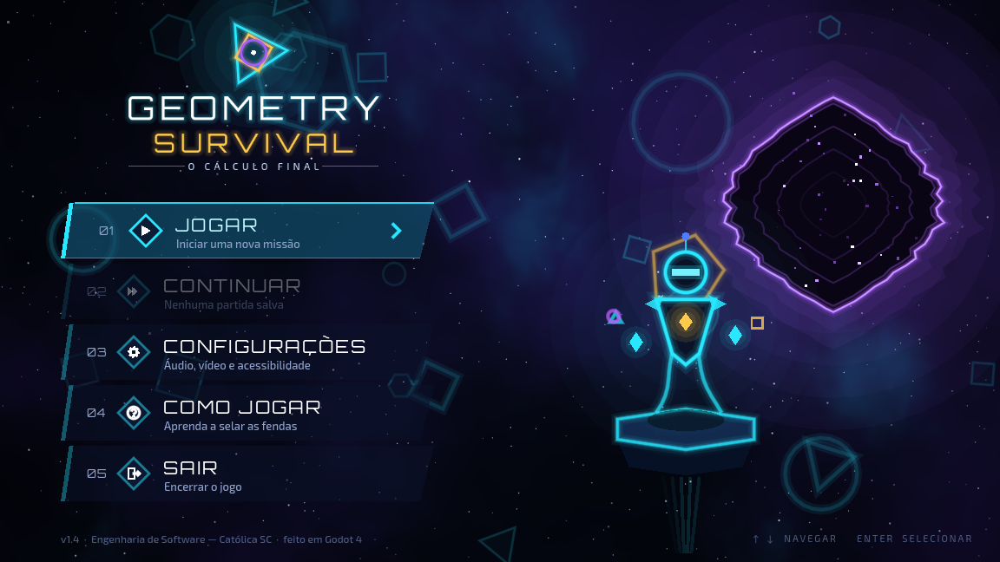

# Geometry Survival: O Cálculo Final



**Geometry Survival** é um jogo sério 2D, feito em Godot, para praticar o **cálculo de áreas de figuras planas** do Ensino Médio.

Você é **Axi-01**, a Arquiteta Dimensional. A Entropia está abrindo **fendas** no Arquipélago Dimensional, e de cada fenda sai uma Forma Caótica (triângulo, quadrado, retângulo, círculo ou forma composta). Para selar a fenda, calcule a área da forma. Antes de responder, consulte **Geo**, sua IA analítica, que mostra o **Risco de Colapso**: arriscar rende mais pontos, mas errar pode custar uma vida.

- **Versão:** v1.4 (Vertical Slice)
- **Público-alvo:** estudantes do Ensino Médio (14 a 18 anos) e professores de Matemática
- **Equipe:** Arthur Schmitt de Freitas, Henrique Tomazoni Andrade, Thauã Brandão da Silva e Vitor Zermiani Leopoldo (Engenharia de Software, PAC, 3ª fase)
- **GDD (Game Design Document):** [`docs/GDD_GeometrySurvival.pdf`](docs/GDD_GeometrySurvival.pdf)

---

## Sumário

1. [Requisitos](#1-requisitos)
2. [Como baixar o projeto](#2-como-baixar-o-projeto)
3. [Instalação e configuração do ambiente](#3-instalação-e-configuração-do-ambiente)
4. [Como executar o jogo](#4-como-executar-o-jogo)
5. [Como iniciar uma partida](#5-como-iniciar-uma-partida)
6. [Controles](#6-controles)
7. [Objetivo e regras](#7-objetivo-e-regras)
8. [Vitória, derrota e progressão](#8-vitória-derrota-e-progressão)
9. [Limitações conhecidas](#9-limitações-conhecidas)
10. [Problemas comuns](#10-problemas-comuns)
11. [Documentação e estrutura do projeto](#11-documentação-e-estrutura-do-projeto)

---

## 1. Requisitos

| Item | Requisito |
|---|---|
| Sistema operacional | Windows 10/11 (64 bits), Linux (64 bits) ou macOS 11 ou superior. Testado em Linux. |
| Engine | **Godot Engine 4.3**, versão **padrão** (não use a versão ".NET / C#") |
| Placa de vídeo | Qualquer uma com suporte a OpenGL 3.3, porque o jogo usa o renderer *Compatibility* |
| Outros programas | Nenhum. Não há plugins, bibliotecas ou assets externos para instalar. |
| Opcional | [Git](https://git-scm.com/downloads), apenas se preferir clonar em vez de baixar o ZIP |
| Periféricos | Teclado e mouse. Caixa de som ou fone é recomendado, pois o jogo tem música e efeitos. |

> Use a versão **4.3**. Versões 4.x mais novas costumam abrir o projeto, mas podem pedir para "converter" e não foram testadas. A versão 3.x **não** funciona.

---

## 2. Como baixar o projeto

**Opção A: baixar o ZIP (mais simples)**

1. Acesse <https://github.com/ThauaBrandao/Geometry-Survival>.
2. Clique no botão verde **Code** e depois em **Download ZIP**.
3. Extraia o ZIP numa pasta de sua preferência, por exemplo `Documentos\Geometry-Survival`.

**Opção B: clonar com Git**

```bash
git clone https://github.com/ThauaBrandao/Geometry-Survival.git
cd Geometry-Survival
```

Nos dois casos, a pasta baixada deve conter o arquivo **`project.godot`**. É ele que o Godot abre.

---

## 3. Instalação e configuração do ambiente

1. Acesse <https://godotengine.org/download/archive/4.3-stable/>.
2. Baixe a versão **Standard** para o seu sistema:
   - **Windows:** `Godot_v4.3-stable_win64.exe.zip`
   - **Linux:** `Godot_v4.3-stable_linux.x86_64.zip`
   - **macOS:** `Godot_v4.3-stable_macos.universal.zip`
3. Extraia o arquivo. O Godot **não precisa de instalação**: basta executar o programa extraído. No macOS, arraste o app para *Aplicativos* e, se o sistema bloquear, clique com o botão direito e escolha **Abrir**.

Nenhuma outra configuração é necessária.

---

## 4. Como executar o jogo

1. Abra o **Godot 4.3**. Aparece a janela **Gerenciador de Projetos**.
2. Clique em **Importar** (no canto superior esquerdo).
3. Clique em **Procurar**, entre na pasta do projeto baixado e selecione o arquivo **`project.godot`**.
4. Clique em **Importar e Editar**.
5. Na primeira abertura, o Godot leva alguns segundos para processar os arquivos (ele cria a pasta `.godot/`). Aguarde até a barra de progresso terminar.
6. Com o editor aberto, pressione **F5** ou clique no botão **▶ (Executar Projeto)** no canto superior direito.
7. A janela do jogo abre na **tela inicial**.

Para fechar o jogo, use a opção **SAIR** do menu principal ou feche a janela.

**Alternativa por linha de comando** (com o executável do Godot no PATH):

```bash
godot --path .            # executa o jogo
godot --path . --editor   # abre o editor
```

**Testes automatizados (opcional, para desenvolvedores):**

```bash
godot --headless --import .              # apenas na primeira vez
godot --headless -s tests/test_runner.gd # código de saída 0 = todos os testes passaram
```

---

## 5. Como iniciar uma partida

1. Na **tela inicial**, pressione qualquer tecla ou clique.
2. No **menu principal**, escolha **JOGAR**. A opção **COMO JOGAR** mostra um resumo ilustrado das regras em 4 páginas e vale a pena ver antes da primeira partida.
3. Você chega ao **Arquipélago Dimensional**, o mapa de setores. No início, só o **Setor Alpha** está liberado. Clique nele ou selecione-o com as setas e pressione Enter.
4. Aparece o cartão de apresentação do setor e começa a **onda 1**:
   - a fenda se abre e uma forma geométrica é desenhada com as medidas indicadas;
   - Geo mostra o **Risco de Colapso** (%) no medidor;
   - digite a área no campo de resposta e pressione **Enter**;
   - leia o resultado (e a resolução passo a passo, se errar) e pressione **Enter** de novo para a próxima onda.
5. Depois das 3 ondas, a tela de **fim de setor** mostra suas estrelas, e o próximo setor é liberado no mapa.

**Continuar depois:** o progresso é salvo automaticamente ao voltar ao mapa. Na próxima vez, use **CONTINUAR** no menu principal.

**Configurações** (no menu): volume da música e dos efeitos, tela cheia, tremor de tela e movimento reduzido.

---

## 6. Controles

| Tecla / ação | O que faz |
|---|---|
| **↑ ↓ ← →** ou **mouse** | Navega pelos menus, pelo mapa de setores e pelas páginas do "Como Jogar" |
| **Enter** ou **clique** | Seleciona uma opção. No encontro, confirma a resposta e depois avança para a próxima onda. |
| **Teclado numérico / números** | Digita a área no campo de resposta |
| **Vírgula** ou **ponto** | Separador decimal, por exemplo `12,5` ou `12.5` |
| **Esc** | Durante o encontro, pausa o jogo. Nos menus, volta para a tela anterior. |
| **Pausa → Voltar ao mapa** | Abandona o setor atual: a pontuação e as vidas voltam ao valor de antes de entrar nele |

---

## 7. Objetivo e regras

**Objetivo:** selar todas as fendas dos três setores (**Alpha → Beta → Gamma**, 3 ondas cada, 9 no total) sem perder as 3 vidas, fazendo a maior pontuação possível.

### Setores e figuras

| Setor | Figuras | Fórmulas usadas |
|---|---|---|
| **Alpha**: Planícies Euclidianas | Quadrado, retângulo, triângulo | `l²`, `b × h`, `(b × h) ÷ 2` |
| **Beta**: Câmara dos Arcos | Círculo (na onda 3 é informado o **diâmetro**, não o raio) | `π × r²` |
| **Gamma**: Nexo da Entropia | Formas compostas: retângulo + triângulo e retângulo + semicírculo. A onda 3 é a "Fenda do Líder Aleatório". | Soma das áreas das partes |

### Resposta

- Digite **só o número** da área, sem unidade.
- São aceitos valores aproximados:
  - **Alpha:** até **±2%** do valor exato;
  - **Beta e Gamma:** até **±5%** do valor exato. Usar π ≈ 3,14 ou até π ≈ 3 é aceito.
- Entradas inválidas (texto, zero, número negativo, `1.2.3`) **não contam como erro**: Geo pede para você digitar de novo.

### Risco de Colapso

Toda fenda mostra um percentual de risco antes de você responder:

| Risco | Acertou | Errou |
|---|---|---|
| **Até 70%** (estável, verde) | **+100 pontos** | Não perde vida; Geo mostra a resolução |
| **Acima de 70%** (instável, vermelho) | **+150 pontos** (100 + 50 de bônus) | **Perde 1 vida**; a fenda se expande |

O risco sobe de setor para setor: Alpha fica entre 10% e 75%, Beta entre 25% e 90% e Gamma entre 40% e 90%.

**Errar nunca trava o jogo.** Depois de qualquer resposta você avança para a próxima onda, e a resolução passo a passo é mostrada para você aprender com o erro.

---

## 8. Vitória, derrota e progressão

- **Progressão:** os setores são liberados em sequência. Ao completar as 3 ondas de um setor, você ganha de 1 a 3 estrelas, conforme os acertos, e o próximo setor é liberado no mapa.
- **Vitória:** selar a última fenda do **Setor Gamma**. A tela de vitória mostra a pontuação final, o desempenho em cada setor e o selo de **NOVO RECORDE**, se for o caso.
- **Derrota:** perder as **3 vidas**, o que só acontece com erros em fendas de risco acima de 70%. A tela de derrota mostra a pontuação, o desempenho e a resolução da última fenda.
- Nas duas telas é possível **jogar de novo** desde o início. O **recorde** fica salvo no computador.

---

## 9. Limitações conhecidas

Esta é a versão **v1.4 (Vertical Slice)**. Ainda não estão prontos:

- **Sem tutorial interativo.** Existe apenas a tela ilustrada "Como Jogar" e este guia.
- **Sem executável pronto.** Para jogar, é preciso abrir o projeto no Godot (seção 4). O export para Windows e Web (HTML5) ainda não foi gerado.
- **Testado apenas no Linux.** Windows, macOS, navegadores e diferentes resoluções ainda não foram testados formalmente. A janela pode ser redimensionada e mantém a proporção.
- **Conteúdo limitado:** 3 setores, 9 ondas e 6 tipos de figura. Não há trapézio, losango, paralelogramo nem níveis de dificuldade selecionáveis.
- **Só área.** Perímetro e outros conteúdos de geometria não estão no jogo.
- **Sem exportação de dados.** O jogo registra as tentativas internamente, mas ainda não exporta relatório ou CSV para o professor.
- **Sem validação com estudantes.** A sessão piloto com o público-alvo ainda não foi feita.
- **Apenas teclado e mouse**, sem suporte a toque ou controle, e **apenas português**.
- O salvamento é **local**: fica na pasta de dados do usuário do Godot (`user://`), sem contas nem nuvem.
- O áudio é gerado por código. O volume pode variar entre caixas de som, e pode ser ajustado em Configurações.

---

## 10. Problemas comuns

| Problema | Solução |
|---|---|
| O Godot pede para "converter" ou "atualizar" o projeto | Você está usando outra versão. Instale a **4.3** (seção 3). |
| Erro sobre C#/.NET ou Mono | Você baixou a versão .NET. Baixe a versão **Standard**. |
| Não acho o `project.godot` ao importar | Se baixou o ZIP, ele pode ter criado uma pasta dentro de outra (`Geometry-Survival-main/...`). Entre até a pasta que contém o arquivo. |
| Muitos avisos amarelos na primeira abertura | São normais durante a primeira importação. Espere terminar e pressione F5. |
| Tela preta ou erro de OpenGL | Atualize o driver de vídeo. O jogo precisa de OpenGL 3.3. |
| Sem som | Confira o volume em **Configurações** e o dispositivo de áudio do sistema. |
| "Continuar" está desativado | Ainda não existe partida salva. O salvamento acontece ao voltar ao mapa. |

---

## 11. Documentação e estrutura do projeto

| Documento | Local |
|---|---|
| **GDD (Game Design Document)** | [`docs/GDD_GeometrySurvival.pdf`](docs/GDD_GeometrySurvival.pdf) |
| EAP (Estrutura Analítica do Projeto) | [`docs/EAP_Geometry_Survival.xlsx`](docs/EAP_Geometry_Survival.xlsx) |
| Histórico de versões | [`docs/CHANGELOG.md`](docs/CHANGELOG.md) |
| Revisão da baseline e backlog | [`docs/Revisao_Baseline_e_Backlog_Geometry_Survival.md`](docs/Revisao_Baseline_e_Backlog_Geometry_Survival.md) |
| Capturas de tela de todas as telas | [`docs/evidencias/v1.4/`](docs/evidencias/v1.4/) |

| Pasta / arquivo | Conteúdo |
|---|---|
| `project.godot` | Arquivo do projeto (abrir no Godot) |
| `scenes/` | Cenas do Godot (`Main.tscn` é a cena inicial) |
| `scripts/GameRules.gd` | Todos os números de balanceamento (pontos, vidas, tolerância, risco) |
| `scripts/` | Lógica do jogo, gerador de formas, validação, salvamento e áudio procedural |
| `scripts/screens/`, `scripts/ui/`, `scripts/fx/` | Telas, componentes de interface e efeitos visuais |
| `shaders/` | Nebulosa, transição e desfoque da pausa |
| `assets/fonts/` | Fontes Orbitron e Exo 2 (licença SIL OFL 1.1) |
| `tests/` | Testes automatizados |

O jogo não usa nenhum sprite nem arquivo de áudio externo: tudo é desenhado e sintetizado por código (Pilar 5 do GDD).
